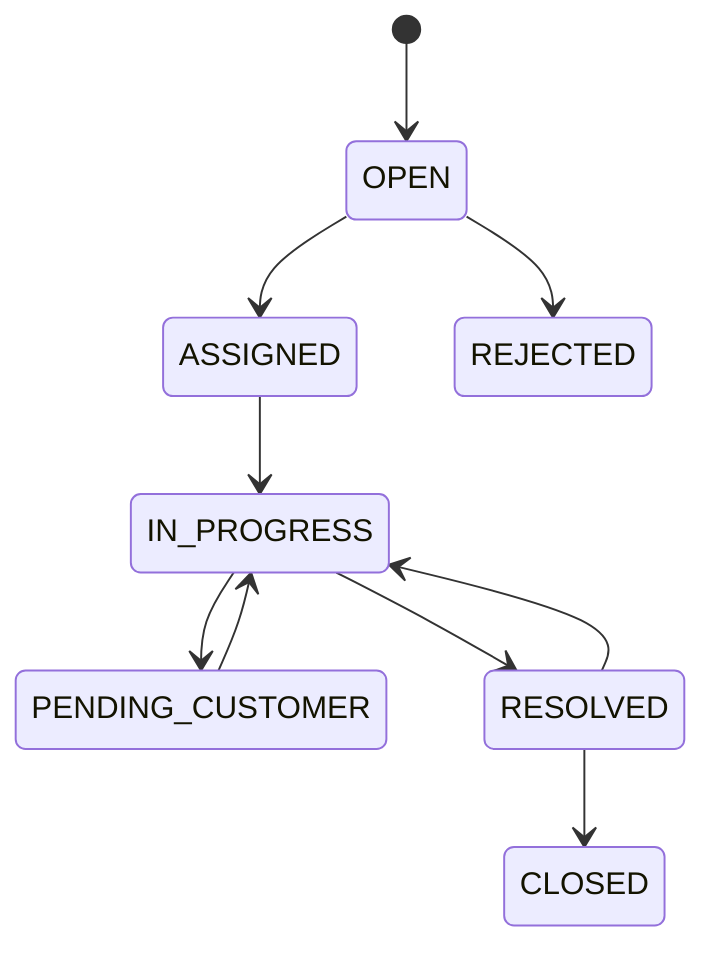

# Claims Management System


REST API that allows a telecommunications company to **register, assign, track and resolve customer claims** (technical issues, billing errors, service requests), with SLA calculation based on Argentine business days and management reports.

> 🚧 **Work in progress** — built following Scrum. See the [release plan](docs/agile/sprint-plan.md).

## What this project demonstrates

| Skill | Evidence |
|---|---|
| Requirements specification | [SRS](docs/requirements/software-requirements-specification.md) · [User stories](docs/requirements/user-stories.md) |
| Process modeling (BPMN, flowcharts) | [docs/process](docs/process/) |
| Data modeling & SQL | [ERD](docs/database/erd.md) · [Flyway migrations](src/main/resources/db/migration) · [SQL queries](database/queries/) |
| REST APIs | Spring Boot API documented with OpenAPI/Swagger · external holidays API integration |
| Agile / Scrum with Jira & Confluence | [Working agreement](docs/agile/working-agreement.md) · [Jira backlog](jira/) · [Sprint reports](docs/agile/sprints/) |

## Tech stack
Java 21 · Spring Boot 3 · Spring Data JPA · PostgreSQL · Flyway · springdoc-openapi (Swagger) · JUnit 5 · Docker · GitHub Actions

## Getting started

**Requirements:** JDK 21 and Docker. Maven is not needed: the Maven Wrapper (`./mvnw`, or `mvnw.cmd` on Windows) downloads Maven 3.9.11 on first use.

```bash
git clone https://github.com/lolofranciscosanchez/claims-management-system.git
cd claims-management-system
docker compose up -d          # PostgreSQL on localhost:5432
./mvnw spring-boot:run        # API on http://localhost:8080 (Windows: mvnw.cmd)
```

- Swagger UI: http://localhost:8080/swagger-ui.html
- Health check: http://localhost:8080/actuator/health

## Project structure
```
docs/
  requirements/   SRS and user stories
  process/        BPMN model and flowcharts
  database/       Entity-Relationship Diagram
  agile/          working agreement, release plan, sprint reports
database/queries/ analytical SQL queries
jira/             backlog ready to import into Jira
src/              Spring Boot application
```

## Claim life cycle


## Author
**Francisco Sánchez** — Information Systems Engineering student · Córdoba, Argentina
