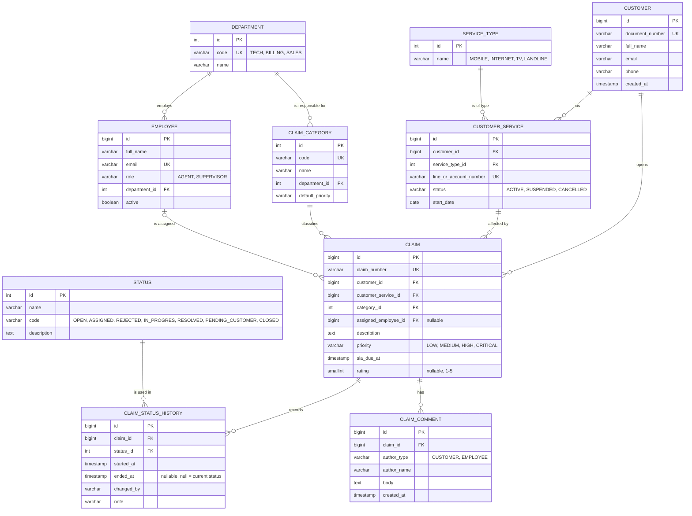

# Entity-Relationship Diagram 

> Draft logical model. Review it, adjust it to your own design decisions and then implement it as a Flyway migration (`src/main/resources/db/migration/V1__create_schema.sql`).

## Design decisions 

| Decision | Reason |
|---|---|
| Claim status history with validity periods (started_at / ended_at) and a STATUS lookup table | No redundancy: the status lives in one place. Time spent in each status is calculated directly. Alternative considered: storing the current status in CLAIM (faster reads, but duplicated data). Trade-off accepted: getting the current status requires a join with the open history record. |
| Claim dates (created_at, resolved_at, closed_at) not stored in CLAIM | They are derived from the status history, so storing them would duplicate data. |
| `sla_due_at` stored, not calculated on each query | Depends on holidays from an external API; storing it makes reports simple and fast. |
| Priority stored in CLAIM, not in STATUS | Priority is a property of each claim and can be changed by a supervisor; two claims in the same status can have different priorities.|
| Catalog relations are 0..N (e.g. DEPARTMENT \|\|--o{ EMPLOYEE) | Mandatory membership is enforced by the NOT NULL FK on the child side; a parent (new department, category or service type) can exist before its first child. |
| assigned_employee_id nullable (EMPLOYEE \|o--o{ CLAIM) | A new claim (OPEN) has no agent until a supervisor assigns one. |

## Suggested indexes and constraints
- Unique partial index `claim_status_history(claim_id) WHERE ended_at IS NULL` → only one current status per claim.
- `CHECK (ended_at IS NULL OR ended_at > started_at)` → valid periods.
- Index `claim_status_history(status_id) WHERE ended_at IS NULL` → "claims currently in status X" (workload, open claims).
- Index `claim(sla_due_at)` → SLA breach report.
- Index `claim(customer_id)` → customer history.
