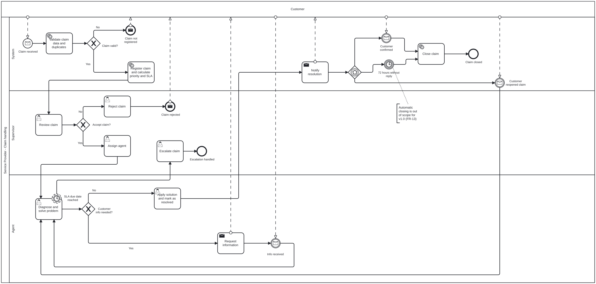
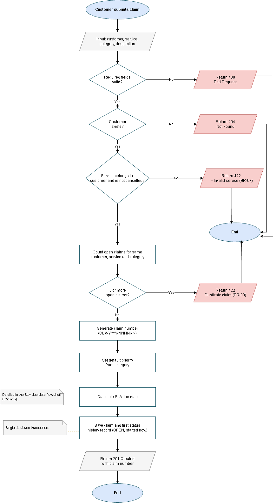

# Process Models

This folder contains the business process models of the claims management process.

## Deliverables

| File | Content | Tool | Status |
|---|---|---|---|
| `claim-handling-process.bpmn` + `.svg` | BPMN 2.0 model of the end-to-end claim process: **Customer** pool (collapsed) and **Service Provider** pool with lanes **System**, **Supervisor** and **Agent**. | bpmn.io | Done |
| `flowchart-open-claim.png` | Flowchart of the "Open claim" use case (validations, duplicate check BR-03, priority and SLA calculation). | draw.io | Done (CMS-14) |
| `flowchart-sla-calculation.png` | Flowchart of the SLA due-date algorithm (business days + holidays + API fallback). | draw.io | To do (CMS-15) |
| `flowchart-status-change.png` | Flowchart of a status change (permission check, transition validation, history record). | draw.io | Optional |

## BPMN elements
- [x] Message start event: *Claim received*
- [x] Exclusive gateway: *Claim valid?* → *Claim not registered* (message end event) / continue
- [x] Service task: *Register claim and calculate priority and SLA* (System lane)
- [x] Exclusive gateway: *Accept claim?* → *Reject claim* → *Claim rejected* (message end event)
- [x] User task: *Assign agent* (Supervisor lane)
- [x] User task: *Diagnose and solve problem* (Agent lane)
- [x] Non-interrupting timer boundary event: *SLA due date reached* → *Escalate claim* (Supervisor lane)
- [x] Exclusive gateway: *Customer info needed?* → *Request information* (send task) → *Info received* (message catch event)
- [x] Event-based gateway after *Notify resolution*: *Customer confirmed* / *Customer reopened claim* / *72 hours without reply*
- [x] End event: *Claim closed*

> Automatic closing after 72 hours is modeled as part of the business process but is out of scope for v1.0 (FR-13).
