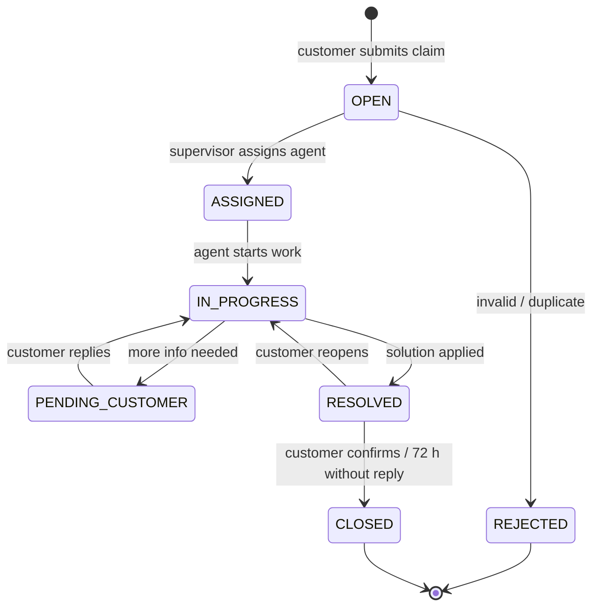

# Software Requirements Specification (SRS)

**Project:** Claims Management System
**Version:** 0.1 (draft)
**Author:** Francisco Sánchez
**Status:** In progress

---

## 1. Introduction

### 1.1 Purpose
This document specifies the functional and non-functional requirements of the **Claims Management System**, a back-end application that allows a telecommunications company to register, assign, track and resolve customer claims (technical issues, billing errors, service requests).

### 1.2 Scope
The system exposes a REST API consumed by:
- **Customers** (through a future web/mobile front-end) to open claims and check their status.
- **Support agents** to work on claims assigned to them.
- **Supervisors** to assign claims, monitor service level agreements (SLA) and get reports.

Out of scope for version 1.0: user interface, payments, real authentication provider integration, notifications by SMS.

### 1.3 Definitions and acronyms

| Term | Definition |
|---|---|
| Claim | A request or complaint opened by a customer about a service. |
| SLA | Service Level Agreement: maximum time (in business hours) to resolve a claim, depending on its category and priority. |
| Department | Internal area responsible for a claim category (e.g. Technical Support, Billing). |
| Agent | Employee who works on claims. |
| Supervisor | Employee who assigns claims and monitors performance. |
| Business day | A weekday that is not a national holiday in Argentina. |
| Status history record | A record of one status of a claim, with the date and time it started and ended. A record without an end date is the claim's current status. |

### 1.4 References
- BPMN 2.0 process model: `docs/process/`
- Entity-Relationship Diagram: `docs/database/erd.md`
- User stories: `docs/requirements/user-stories.md`

---

## 2. Overall description

### 2.1 Product perspective
Stand-alone back-end service built with Java 21, Spring Boot 3 and PostgreSQL, documented with OpenAPI (Swagger).

### 2.2 User classes

| Actor | Description |
|---|---|
| Customer | Holder of one or more telecom services (mobile line, internet, TV). |
| Agent | Belongs to one department; resolves claims. |
| Supervisor | Manages a department; assigns and escalates claims. |
| External system | Public holidays API used to calculate SLA due dates. |

### 2.3 Claim life cycle (summary)

> The detailed BPMN model (with swimlanes for Customer, Supervisor, Agent and System) is in `docs/process/`.

### 2.4 Assumptions and constraints
- Authentication is simulated (role sent in a header) in version 1.0.
- All dates are stored in UTC and shown in `America/Argentina/Buenos_Aires`.
- The documentation and source code are written in English.

---

## 3. Functional requirements

| ID | Requirement | Priority |
|---|---|---|
| FR-01 | The system shall allow registering a customer with document number, full name, email and phone. | Must |
| FR-02 | The system shall allow a customer to open a claim indicating category, description and affected service. | Must |
| FR-03 | The system shall generate a unique, human-readable claim number (e.g. `CLM-2026-000123`). | Must |
| FR-04 | The system shall assign a priority (LOW, MEDIUM, HIGH, CRITICAL) based on the category, which a supervisor can override. | Should |
| FR-05 | The system shall calculate the SLA due date using business days, excluding Argentine national holidays obtained from an external API. | Must |
| FR-06 | A supervisor shall be able to assign a claim to an agent of the responsible department. | Must |
| FR-07 | The system shall only allow the status transitions defined in section 2.3 and reject invalid ones with an error message. | Must |
| FR-08 | The system shall keep a complete, chronologically ordered history of each claim’s statuses, including when each status started and ended and the user who made each change.| Must |
| FR-09 | Agents and customers shall be able to add comments to a claim. | Should |
| FR-10 | The system shall allow searching claims by status, category, department, customer and date range, with pagination. | Must |
| FR-11 | The system shall provide reports: claims by status, average resolution time per department, top claim categories, and claims that breached the SLA. | Must |
| FR-12 | The system shall identify claims as "SLA breached" when the due date passes and the claim is not resolved. | Should |
| FR-13 | A resolved claim shall be closed automatically after 72 hours without customer response. | Could (out of scope for v1.0) |
| FR-14 | The customer shall be able to rate the solution (1 to 5) when the claim is closed. | Could |

---

## 4. Non-functional requirements

| ID | Category | Requirement |
|---|---|---|
| NFR-01 | Performance | 95% of API requests shall respond in less than 500 ms with 10,000 claims in the database. |
| NFR-02 | Documentation | All endpoints shall be documented with OpenAPI and visible in Swagger UI. |
| NFR-03 | Maintainability | Layered architecture (controller → service → repository). Business rules live only in the service layer. |
| NFR-04 | Quality | Service layer unit test coverage of at least 70%. CI pipeline must pass before merging. |
| NFR-05 | Data integrity | Database schema versioned with Flyway; foreign keys and constraints enforced at database level. |
| NFR-06 | Error handling | Errors returned in a consistent JSON format (`timestamp`, `status`, `error`, `message`, `path`). |
| NFR-07 | Resilience | If the holidays API is unavailable, the system shall fall back to weekday-only calculation and log a warning. |
| NFR-08 | Portability | The database shall start with a single `docker compose up` command. |
| NFR-09 | Language | Code, commits, and documentation in English. |

---

## 5. Business rules

| ID | Rule |
|---|---|
| BR-01 | Default SLA by priority: CRITICAL 8 business hours, HIGH 24, MEDIUM 48, LOW 72. |
| BR-02 | A claim can only be assigned to an agent belonging to the department responsible for its category. |
| BR-03 | A customer cannot have more than 3 open claims for the same service and category (to avoid duplicates). |
| BR-04 | A claim in status CLOSED or REJECTED cannot be modified. |
| BR-05 | Only a supervisor can change the priority or reject a claim. |
| BR-06 | When a claim changes status, the end of the previous status and the start of the new one shall have the same timestamp, so the history has no gaps or overlaps. |

---

## 6. Traceability matrix

| Requirement | User story | Jira tickets | Jira epic |
|---|---|---|---|
| FR-01 | US-01 | CMS-23 | CMS-4 – Customers & Catalog API |
| FR-02, FR-03 | US-02 | CMS-25 | CMS-5 – Claims API |
| FR-04 | US-02 | CMS-25 | CMS-5 – Claims API |
| FR-05 | US-05 | CMS-31, CMS-32 | CMS-6 – External API Integration |
| FR-06 | US-03 | CMS-27 | CMS-5 – Claims API |
| FR-07 | US-04 | CMS-26 | CMS-5 – Claims API |
| FR-08 | US-03, US-04 | CMS-26, CMS-27 | CMS-5 – Claims API |
| FR-09 | US-07 | CMS-29 | CMS-5 – Claims API |
| FR-10 | US-06 | CMS-28 | CMS-5 – Claims API |
| FR-11 | US-08 | CMS-33 | CMS-7 – Reporting |
| FR-12 | US-08 | CMS-33 | CMS-7 – Reporting |
| FR-13 | — | — | Out of scope for v1.0 (Could priority) |
| FR-14 | US-09 | CMS-35 | CMS-5 – Claims API |
